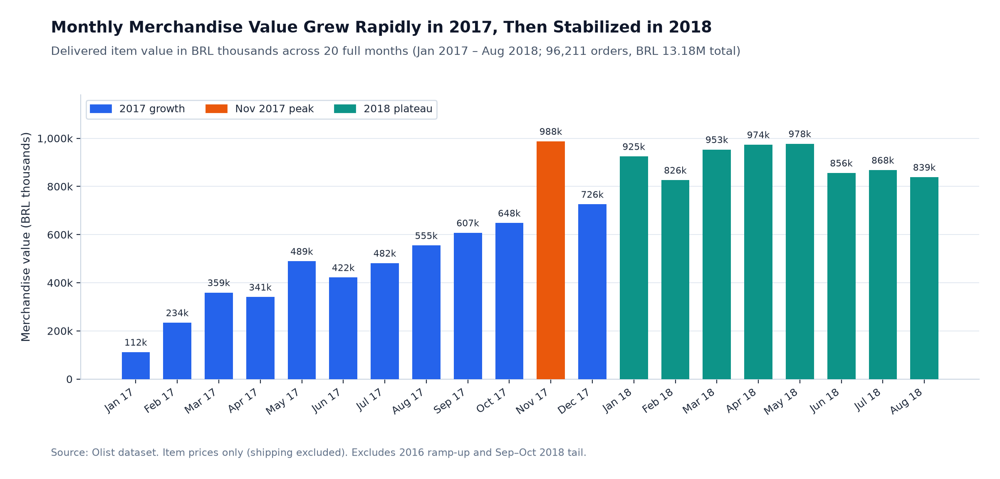
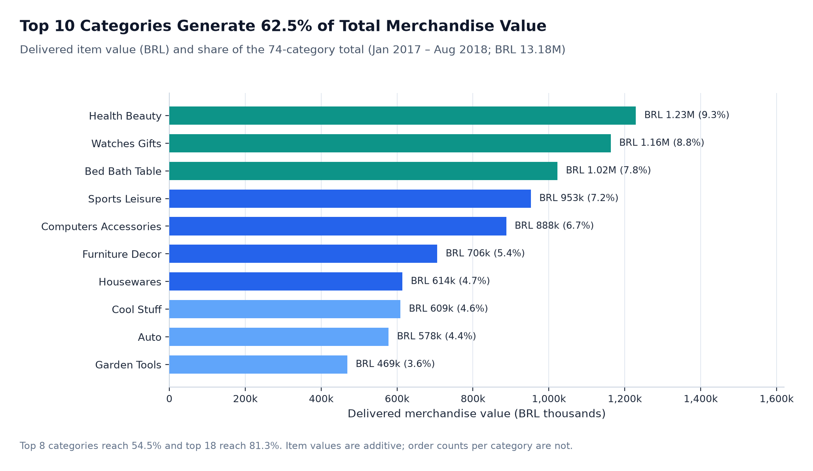
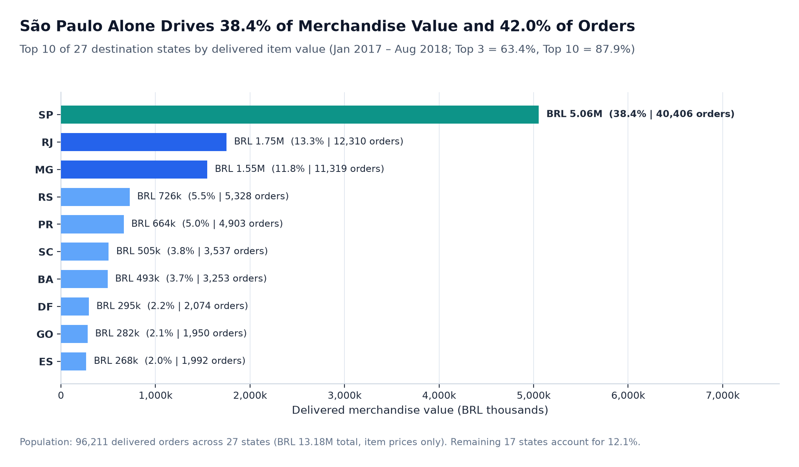
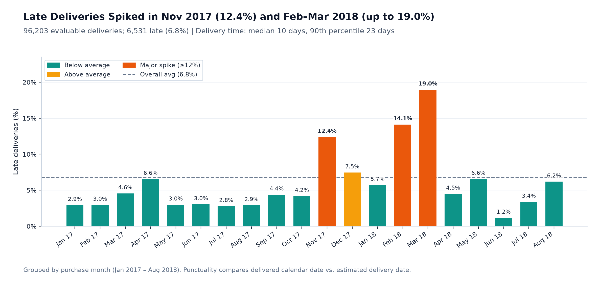
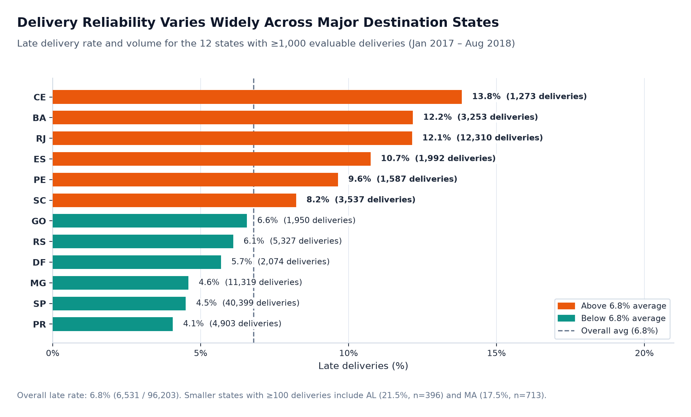
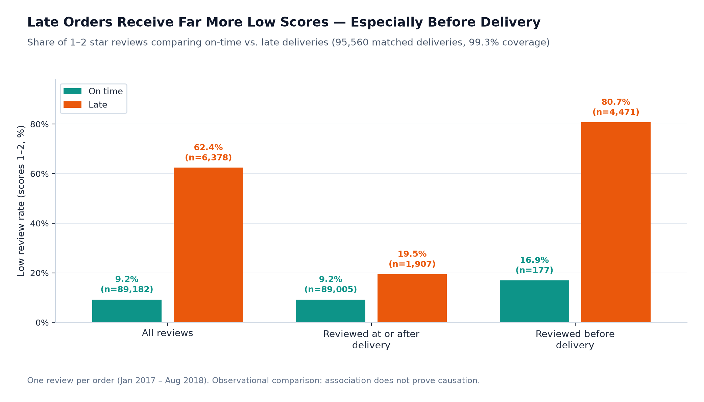

# Olist Marketplace Performance

**Independent portfolio project** analyzing sales concentration, delivery reliability, and customer review scores on the [Brazilian E-Commerce Public Dataset by Olist](https://www.kaggle.com/datasets/olistbr/brazilian-ecommerce) (`Jan 2017 – Aug 2018`, **96,211** delivered orders, **BRL 13.18M** merchandise value).

**Stack:** Python (`pandas`, `matplotlib`), SQL (`DuckDB`), and Excel (independent formula reconciliation).

---

## Key Findings (Jan 2017 – Aug 2018)

1. **Sales grew rapidly in 2017, stabilized in 2018, and concentrate heavily in top categories and states:** Delivered orders rose from `750` in Jan 2017 (`BRL 112k`) to a peak of `7,289` in Nov 2017 (`BRL 988k`, `+62.8%` orders MoM), dropped `-24.4%` in Dec 2017, and plateaued in 2018 (`6,099–7,069` orders/month; `BRL 826k–978k/month`). Out of `74` categories, the top `10` generate **`62.5%`** of merchandise value (top `8` = `54.5%`, top `18` = `81.3%`). Geographically, **São Paulo (`SP`)** alone accounts for **`38.4%`** of merchandise value and **`42.0%`** of orders (`40,406`); the top 3 states (`SP`, `RJ`, `MG`) generate **`63.4%`**.
2. **Delivery delays average `6.8%` overall, but spike in peak periods and diverge sharply across major states:** Across `96,203` evaluable deliveries (median `10` days, 90th percentile `23` days), `6,531` arrived after the promised calendar date (`6.79%`; median delay `7` days, p90 `22` days). Late rates spiked to **`12.4%`** in Nov 2017, **`14.1%`** in Feb 2018, and **`19.0%`** in Mar 2018 (`1,328` late), before dropping to **`1.2%`** in Jun 2018. Among the `12` states with `≥1,000` deliveries, late rates range from `4.1%` (`PR`) and `4.5%` (`SP`) up to **`12.1%`** in `RJ` (`n=12,310`, `1,495` late deliveries), **`12.2%`** in `BA`, and **`13.8%`** in `CE`.
3. **Late orders receive far more 1–2 star reviews (`62.4%` vs. `9.2%`), driven mainly by surveys answered before delivery:** Across `95,560` matched deliveries (`99.3%` review coverage), low review scores occur on **`62.4%`** of late orders (`n=6,378`) vs. **`9.2%`** of on-time orders (`n=89,182`), holding consistently across all `14` states with `≥100` reviews per group (`8.6%–11.3%` on-time vs. `52.1%–73.1%` late). Separating by answer timing shows **`80.7%`** low scores when late orders are reviewed *before* delivery (`n=4,471`) vs. **`19.5%`** when reviewed *at or after* delivery (`n=1,907`).

Read the full manager-facing memo and recommendations in **[`docs/executive_summary.md`](docs/executive_summary.md)**.

---

## Documentation

| Document | Contents |
|---|---|
| [`docs/executive_summary.md`](docs/executive_summary.md) | One-page business memo: findings, priority recommendations, boundaries, and next data needed |
| [`docs/methodology.md`](docs/methodology.md) | Business brief, population definitions, data dictionary, SQL precision, and USD view conventions |
| [`docs/data_quality.md`](docs/data_quality.md) | Quantified keys, missing values, anomalies, exclusions, and main-period selection |
| [`docs/data_source_and_license.md`](docs/data_source_and_license.md) | Kaggle source, version, CC BY-NC-SA 4.0 terms, and redistribution rules |

---

## Visual Highlights

### 1. Sales — How do order volume and merchandise value vary over time, across categories, and across states?







### 2. Service — Where do late deliveries and long delivery times concentrate?





### 3. Experience — How does delivery punctuality relate to customer review scores?



---

## Workflow and Traceability

```text
data/raw/*.csv  ─▶  Pandas_Analysis/ (quality checks & 3 analyses)  ─▶  charts/generate_charts.py (6 PNGs)
                └─▶  sql_Analysis/ (DuckDB analytical tables & 10 queries)
                └─▶  Excel_Analysis/check_Olist.xlsx (independent SUMIFS / COUNTIFS check)
```

Every chart and finding traces directly back to both the Python scripts and the SQL queries:

| Business question | Python script (`Pandas_Analysis/`) | SQL query (`sql_Analysis/analysis.sql`) | Visual (`charts/images/`) |
|---|---|---|---|
| **Sales — monthly trend** | [`sales_analysis.py`](Pandas_Analysis/sales_analysis.py) (`sales_by_month`) | Queries 1 & 6 | [`01_monthly_sales.png`](charts/images/01_monthly_sales.png) |
| **Sales — categories** | [`sales_analysis.py`](Pandas_Analysis/sales_analysis.py) (`sales_by_category`) | Queries 2 & 7 | [`02_top_categories.png`](charts/images/02_top_categories.png) |
| **Sales — destination states** | [`sales_analysis.py`](Pandas_Analysis/sales_analysis.py) (`orders_by_state`) | Query 3 | [`03_sales_by_state.png`](charts/images/03_sales_by_state.png) |
| **Service — monthly delays** | [`service_analysis.py`](Pandas_Analysis/service_analysis.py) (`deliveries_by_month`) | Queries 4, 8, 9 & 10 | [`04_late_deliveries_by_month.png`](charts/images/04_late_deliveries_by_month.png) |
| **Service — state reliability** | [`service_analysis.py`](Pandas_Analysis/service_analysis.py) (`deliveries_by_state`) | Pandas only | [`05_late_deliveries_by_state.png`](charts/images/05_late_deliveries_by_state.png) |
| **Experience — punctuality & timing** | [`experience_analysis.py`](Pandas_Analysis/experience_analysis.py) (`summarize_punctuality_scores`, `punctuality_scores_by_state`) | Query 5 | [`06_punctuality_vs_reviews.png`](charts/images/06_punctuality_vs_reviews.png) |

---

## Repository Structure

```text
Pandas_Analysis/     Data quality verification scripts and the three business analyses (sales, service, experience)
sql_Analysis/        DuckDB runner, analytical tables (DECIMAL(18,2)), and 10 analysis queries
Excel_Analysis/      Independent Excel reconciliation workbook (embedded copy and formulas)
charts/              Matplotlib chart generator reusing Pandas_Analysis/ functions + exported PNGs (charts/images/)
data/                Download instructions (raw CSVs and local DuckDB stay out of Git)
docs/                Executive summary, methodology, data quality report, and license details
```

---

## How to Reproduce

### 1. Setup and raw data

Download the Olist CSV files from [Kaggle](https://www.kaggle.com/datasets/olistbr/brazilian-ecommerce) into `data/raw/` following [`data/README.txt`](data/README.txt), then create the virtual environment:

```powershell
python -m venv .venv
.\.venv\Scripts\Activate.ps1
pip install -r requirements.txt
```

### 2. Data quality checks

Reproduces every count in [`docs/data_quality.md`](docs/data_quality.md):

```powershell
python Pandas_Analysis/run_checks.py
```

| Script | Reproduces |
|---|---|
| `checks_structure_keys.py` | Section 1 — structure, uniqueness, and referential integrity |
| `checks_dates_amounts.py` | Section 2 — types, date conversion, decimal precision, and totals |
| `checks_missing_values.py` | Section 3 — missing values across orders, products, and reviews |
| `checks_anomalies.py` | Section 4 — quantified anomalies and exclusions |
| `checks_temporal_coverage.py` | Section 5 — monthly coverage and main-period selection |

### 3. Python analyses and charts

Run each analysis from the repository root:

```powershell
python Pandas_Analysis/sales_analysis.py
python Pandas_Analysis/service_analysis.py
python Pandas_Analysis/experience_analysis.py
```

Regenerate all six PNG charts in `charts/images/`:

```powershell
python charts/generate_charts.py
```

### 4. SQL stage (DuckDB)

Imports the raw CSVs, builds `clean_orders` (one row per order) and `clean_items` (one row per item) with `DECIMAL(18,2)` monetary precision, runs all verification checks and 10 analysis queries, and exports local `data/olist.duckdb`, `data/clean_orders.csv`, and `data/clean_items.csv`:

```powershell
python sql_Analysis/run_sql.py
```

- [`sql_Analysis/create_tables.sql`](sql_Analysis/create_tables.sql) — pre-aggregates items, payments, and deduplicated reviews before joining onto `orders`, preventing row multiplication.
- [`sql_Analysis/analysis.sql`](sql_Analysis/analysis.sql) — 9 analysis blocks / 10 queries covering monthly trends, MoM changes (`LAG`), category concentration (window functions), delivery delays, and review timing.

### 5. Excel reconciliation

[`Excel_Analysis/check_Olist.xlsx`](Excel_Analysis/check_Olist.xlsx) embeds copies of the orders and items tables and recomputes the core metrics with `COUNTIFS` and `SUMIFS` (zero difference against Python and SQL):

| Check | Reconciled value |
|---|---:|
| Total orders (full dataset) | 99,441 |
| Total items (full dataset) | 112,650 |
| Delivered orders in main period (`2017-01` → `2018-08`) | 96,211 |
| Delivered merchandise value in main period | 13,181,027.13 BRL |
| Delivered orders placed in Nov 2017 | 7,289 |
| Delivered merchandise value in Nov 2017 | 987,765.37 BRL |

---

## Boundaries and License

- **Analytical boundaries:** Merchandise value reflects delivered item prices in BRL (shipping excluded), not Olist's accounting revenue or profit. `freight_value` is a recorded shipping charge, not carrier cost. Comparisons between delivery punctuality and review scores are observational and do not prove causation.
- **Data source & license:** [Brazilian E-Commerce Public Dataset by Olist](https://www.kaggle.com/datasets/olistbr/brazilian-ecommerce) is licensed under **CC BY-NC-SA 4.0**. Raw CSV files are not committed to this repository; derivative data artifacts (`Excel_Analysis/check_Olist.xlsx`) are shared under the same **CC BY-NC-SA 4.0** license (see [`docs/data_source_and_license.md`](docs/data_source_and_license.md)).
